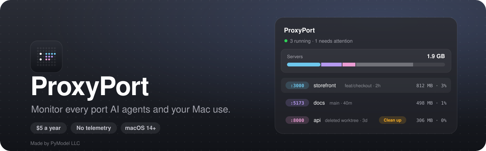

<p align="center">
  <a href="https://proxyport.pymodel.com"></a>
</p>

<p align="center">
  
  
  
  
  
  
  
</p>

<p align="center">Made by <a href="https://pymodel.com">PyModel LLC</a>. Site: <a href="https://proxyport.pymodel.com">proxyport.pymodel.com</a></p>

This repository holds ProxyPort's releases, changelog and issue tracker. The app's source code is private.

## What it's for

Working with coding agents and git worktrees leaves dev servers running everywhere. A few hours in, you have six `localhost` ports open, two of them from a branch you deleted, one slowly eating memory, and no idea which agent started which.

ProxyPort lives in the menu bar and answers that at a glance. For each server it shows the port, project, git branch and uptime, how much memory and CPU it uses, its network traffic and open connections, and the coding agent that started it: the session for Claude Code, Codex, Pi and OpenCode, and the agent itself for Cursor, Kiro, Antigravity, Copilot CLI, Amp, Goose, Qwen Code, Cline, Kimi Code, Droid, Auggie and Kilo Code. You can open it, restart it or stop its whole process tree in one click, and Clean up finds the ones you forgot about.

It reads everything from your own Mac (`lsof`, `sysctl`, `nettop` and local session files). There's no account and no telemetry.

## Install

Download `ProxyPort-<version>.dmg` from [proxyport.pymodel.com](https://proxyport.pymodel.com), open it and drag ProxyPort to Applications. It's signed with an Apple Developer ID and notarized, so it opens like any other app. Each version is also on [Releases](https://github.com/PyModel/ProxyPort/releases), with a SHA-256 checksum next to the disk image.

ProxyPort needs a license key, bought at [proxyport.pymodel.com/buy](https://proxyport.pymodel.com/buy) (sold through Polar). Until one is entered, the popover asks for it and the app shows nothing. A key works on one Mac at a time for its term. To move it, use Settings → License → Deactivate This Mac, or free a Mac you no longer have on your Polar purchases page ([proxyport.pymodel.com/account](https://proxyport.pymodel.com/account)).

The first launch walks you through notifications, launch at login and the `proxyport` command.

## How to use it

### The popover

Click the dot icon in the menu bar, or press ⌥⌘P from anywhere. The icon shows how many servers are running and turns amber when one needs attention.

The popover opens with a memory card: how much your servers use, set against the rest of the Mac. Below it is one row per server. With one to three servers each row shows the port and name, where it runs and for how long, then memory, CPU, traffic and connections. With four or more, rows collapse to one line each so the list stays short. If a scan stalls (a folder on a network mount that never answers, say) or fails, the header says which, and the list stays from the last scan that finished.

On a row you can:

- click it for the server's page, with ten minutes of memory, CPU and traffic charts and its full process tree
- use the open and stop buttons on the right
- right-click for Details, Open, Copy URL, Restart and Stop
- follow a server's output in your terminal from its Details menu (Show Log), when it writes to a file or runs in a container

Restart reruns the original command in the same folder — directly, with no shell, so no shell startup file runs — with the command's own environment. It stops the server first and launches only when every process has exited and every port the server held is free; when it can't, it says why, naming the process still holding a port. A command that fails to start is reported as a failed Restart, with the command's output in its own log under `~/Library/Logs/ProxyPort`. Restart is off, with the reason shown, for a process that renamed itself (its command can't be rerun) and for a server managed by pm2. Stop sends SIGTERM to the server and the runner that started it (`npm run dev`, `uvicorn --reload`, `nodemon`) and force quits whatever is left after a few seconds. A coding agent, notebook or shell above the runner is never stopped. A pm2 app is shown but marked as pm2's, and never stopped or restarted by ProxyPort: pm2 restarts what it owns.

### Containers

Containers from OrbStack, Docker Desktop, Colima or Podman show up as servers on the ports they publish, named for their compose service, with their own memory and CPU from `docker stats`. Stop and Restart use `docker stop` and `docker restart`, and Clean Up only ever suggests a container. It needs the `docker` command and a local Docker context; turn it off in Settings → Ports & processes.

Right-clicking the menu bar icon gives a short menu: open a server in the browser, Settings, Check for Updates and Quit.

### Clean up

Clean up lists servers that look forgotten: their worktree was deleted, they've been idle (no CPU, connections or network traffic) for a few hours, the terminal or agent that started them is gone (orphaned), or they've been running for days. Select the ones to stop and stop them together. In Settings → Clean up you can make this automatic (it stops only deleted-worktree and idle servers; orphaned, long-running and container servers are only suggested), change the thresholds, and protect processes like `postgres` or `redis-server` so they are never suggested.

### Alerts

ProxyPort sends a notification when a server goes over your memory limit (2 GB by default), grows by more than 500 MB in ten minutes, or keeps high CPU, traffic or connection counts. Each alert has Details, Stop and Snooze buttons, plus Restart on a memory alert for a server ProxyPort can restart. Thresholds live in Settings → Alerts.

### The `proxyport` command

The same servers are available in the terminal. Add the command from Settings → General → Terminal, then:

```bash
proxyport                      # browse, open and stop servers (press ? for keys)
proxyport list                 # print servers and exit (exit 75 if the scan stalls or fails: try again)
proxyport list --json          # the same, as JSON, for scripts and agents (--redact hides arguments, paths, titles)
proxyport list --json --watch  # a line of JSON each time the list changes
proxyport list --all           # also other listeners and background containers, and why they aren't servers
proxyport 3000                 # the details of the server on :3000 (--json too)
proxyport stop 3000            # stop it (several ports or a range such as 3000-3010; --dry-run shows the plan)
proxyport restart 3000         # rerun its command in its folder
proxyport logs 3000 -f         # follow what it writes
proxyport name 3000 storefront # name the port; the name shows in place of the project
proxyport wait 3000 --http /health  # block until it answers (agents: instead of sleeping)
proxyport next 3000            # the first free port from 3000
proxyport completion zsh       # shell completion (bash and fish too)
proxyport --version
```

It shares settings with the menu bar app.

#### For coding agents

- `proxyport install hooks` adds a Claude Code SessionEnd hook: when a session exits, the servers it started stop (not on `/clear` or `/resume`). `--print` shows it, `--remove` takes it out. By hand: `proxyport stop --session <id>` or `--agent claude-code`.
- `proxyport mcp` serves ProxyPort's tools over MCP: list and inspect servers, a free port, wait for a port, a server's logs, and Stop for the agent's own servers (another one only with the user's say-so). `proxyport install mcp` prints how to add it to Claude Code, Cursor or Codex.

### Settings

| Pane | What you set |
|---|---|
| General | Software updates, start at login, menu bar icon style, which cards the popover shows, your editor and terminal, the ⌥⌘P shortcut, scan interval |
| Alerts | Memory limit, leak warnings, CPU, traffic and connection alerts, snooze length |
| Clean up | Ask or stop automatically, idle and age thresholds, protected processes, force quit delay |
| Ports & processes | Port range, containers, and processes to watch |
| Integrations | Linking to 16 coding agents and Conductor, branch names, pull requests |
| License | Activate a key, see when it was last checked and when it ends, deactivate this Mac, buy or renew, manage on Polar |
| About | Version and privacy |

Pull request lookup is off by default. When you turn it on it uses the GitHub CLI you're already signed in to.

## Privacy and network

ProxyPort makes two kinds of request to the internet:

- **Updates.** Once a day it fetches ProxyPort's signed update feed from proxyport.pymodel.com and tells you when a newer release is out. It installs an update only when you say so, after checking its signature. Turn the daily check off in Settings → General.
- **License.** When you activate, about once a week after that, and when you deactivate, it asks Polar (`api.polar.sh`) whether your key is valid on this Mac. It sends the key, its activation id, a one-way hash of the Mac's hardware id, the Mac's model and nothing else. Without a connection it keeps working for 30 days.

Nothing about you or your servers is sent.

The optional pull request lookup goes through your own `gh` login. Nothing else leaves your Mac.

## Help

- Found a bug or want something new? [Open an issue](https://github.com/PyModel/ProxyPort/issues/new/choose). Issues are public: don't post license keys, email addresses or order details.
- How it works: [the docs](https://proxyport.pymodel.com/docs). What changed: [CHANGELOG.md](CHANGELOG.md).
- License or billing: [your account](https://proxyport.pymodel.com/account), or email hello@pymodel.com.
- Security problem: see [SECURITY.md](SECURITY.md).

## License

© 2026 PyModel LLC. All rights reserved. ProxyPort is proprietary software, used under the [ProxyPort License Agreement](LICENSE): a license key activates it on one Mac at a time for the key's term. Bundled third-party code and marks keep their own licenses: [THIRD_PARTY_NOTICES.md](THIRD_PARTY_NOTICES.md).
